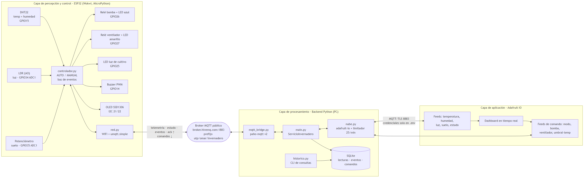

## Grupo 9 - Parcial 2

Integrantes

# Omar Navas

# Daniel Smith

# Winston Franco

# Jorge Mendoza

# 🌱 Invernadero Inteligente IoT

**Parcial #2 — Desarrollo de Software VIII (UTP)** · Escenario 2: _Invernadero Inteligente_

Sistema IoT completo que monitorea y controla un invernadero simulado:

- Un **ESP32 con MicroPython** (simulado en [Wokwi](https://wokwi.com)) lee temperatura, humedad, luz y humedad de suelo, controla bomba, ventilador, luz de cultivo, buzzer y pantalla OLED, y se comunica por **MQTT** (HiveMQ).
- Un **backend Python** en la PC guarda todo en **SQLite** (lecturas, eventos y comandos) y hace de puente con **Adafruit IO**, donde está el **dashboard en tiempo real** y desde donde se envían **comandos remotos** al dispositivo.

## Arquitectura



```
ESP32 (Wokwi, MicroPython) ⇄ MQTT broker.hivemq.com:1883 ⇄ Backend Python (PC) ⇄ Adafruit IO (MQTT/TLS)
                                                              └→ SQLite
```

- El ESP32 **no conoce las credenciales de Adafruit IO**: solo habla con HiveMQ. La `AIO_KEY` vive únicamente en el `.env` del backend.
- **SQLite vive en el backend** porque MicroPython no tiene motor SQL y el ESP32 tiene poca RAM y una flash que se desgasta.

Documentación detallada:

| Documento                                    | Contenido                                                                                               |
| -------------------------------------------- | ------------------------------------------------------------------------------------------------------- |
| [docs/arquitectura.md](docs/arquitectura.md) | Capas, componentes, programación orientada a eventos, decisiones de diseño, seguridad y modelo de datos |
| [docs/flujo_datos.md](docs/flujo_datos.md)   | Diagramas de secuencia sensor → nube y comando nube → actuador, estados de la condición crítica         |
| [docs/config_nube.md](docs/config_nube.md)   | Configuración de Adafruit IO: feeds, bloques del dashboard y límites del plan gratuito                  |

## Componentes y pines

| Componente                     | Parte Wokwi                        | Pin ESP32       | Función                                                             |
| ------------------------------ | ---------------------------------- | --------------- | ------------------------------------------------------------------- |
| DHT22                          | `wokwi-dht22`                      | GPIO15          | Temperatura y humedad del aire                                      |
| Fotorresistencia (LDR)         | `wokwi-photoresistor-sensor` (AO)  | GPIO34 (ADC1)   | Nivel de luz 0–100 % (polaridad invertida: más luz = menos voltaje) |
| Potenciómetro                  | `wokwi-potentiometer`              | GPIO35 (ADC1)   | Simula la humedad del suelo 0–100 %                                 |
| Relé bomba + LED azul          | `wokwi-relay-module` + `wokwi-led` | GPIO26          | Bomba de riego (el LED se enciende por COM→NO)                      |
| Relé ventilador + LED amarillo | `wokwi-relay-module` + `wokwi-led` | GPIO27          | Ventilación (el LED se enciende por COM→NO)                         |
| LED blanco + 220 Ω             | `wokwi-led`                        | GPIO25          | Luz de cultivo                                                      |
| OLED SSD1306 128×64            | `board-ssd1306` (0x3C)             | SDA 21 · SCL 22 | Panel local con lecturas, modo y actuadores                         |
| Buzzer                         | `wokwi-buzzer`                     | GPIO14 (PWM)    | Alarma crítica intermitente                                         |

Los analógicos van solo en **ADC1** (GPIO32–39), porque ADC2 no funciona con WiFi activo. Se usa atenuación de 11 dB.

## Lógica de control

| Modo                   | Ventilador                                      | Bomba                                                          | Luz de cultivo                |
| ---------------------- | ----------------------------------------------- | -------------------------------------------------------------- | ----------------------------- |
| **AUTO** (por defecto) | ON si T > umbral (30 °C); OFF si T < umbral − 2 | ON si suelo < 30 %; máx. 10 s por ciclo y 30 s de enfriamiento | ON si luz < 30 % (OFF > 35 %) |
| **MANUAL**             | Solo por comando                                | Solo por comando                                               | Sigue automática              |

- **Condición crítica** (siempre): T > 38 °C o suelo < 10 % → buzzer intermitente + evento `CRITICO` (una sola vez al entrar) y `CRITICO_RESUELTO` al salir.
- Los comandos de bomba/ventilador en AUTO se responden con `IGNORADO_MODO_AUTO`. `umbral_temp` funciona en ambos modos y se valida en el rango 20–45.

## Topics MQTT (HiveMQ) y feeds (Adafruit IO)

Prefijo configurable: `utp/omar/invernadero` (en `wokwi/config.py` **y** en `.env`).

| Topic                    | Dirección                                 | Ejemplo de payload                                                                                     |
| ------------------------ | ----------------------------------------- | ------------------------------------------------------------------------------------------------------ |
| `{prefijo}/telemetria`   | ESP32 → backend, cada 15 s                | `{"temperatura":24.1,"humedad":60.2,"luz":72,"suelo":45,"ts":1763900000}`                              |
| `{prefijo}/estado`       | ESP32 → backend, al cambiar y al conectar | `{"modo":"AUTO","bomba":false,"ventilador":true,"luz_cultivo":false,"umbral_temp":30,"critico":false}` |
| `{prefijo}/eventos`      | ESP32 → backend                           | `{"tipo":"RIEGO_INICIADO","detalle":"Suelo seco 25%","severidad":"INFO"}`                              |
| `{prefijo}/comandos`     | backend → ESP32                           | `{"cmd":"bomba","valor":"ON","origen":"adafruit_io","id":7}`                                           |
| `{prefijo}/comandos/ack` | ESP32 → backend                           | `{"cmd":"bomba","valor":"ON","resultado":"OK","origen":"adafruit_io","id":7}`                          |

| Feed Adafruit IO                         | Sentido                          | Bloque del dashboard       |
| ---------------------------------------- | -------------------------------- | -------------------------- |
| `temperatura`, `humedad`, `luz`, `suelo` | backend → nube (cada 15 s)       | Gauges + gráfico de líneas |
| `estado`                                 | backend → nube (solo al cambiar) | Texto                      |
| `modo`                                   | nube → ESP32                     | Toggle AUTO/MANUAL         |
| `bomba`, `ventilador`                    | nube → ESP32                     | Toggles ON/OFF             |
| `umbral-temp`                            | nube → ESP32                     | Slider 20–45               |

Tipos de evento: `INICIO_SISTEMA`, `RIEGO_INICIADO`, `RIEGO_FINALIZADO`, `VENTILADOR_ON/OFF`, `LUZ_CULTIVO_ON/OFF`, `CAMBIO_MODO`, `UMBRAL_ACTUALIZADO`, `CRITICO`, `CRITICO_RESUELTO` y `ERROR_SENSOR`.

## Estructura del proyecto

```
├── wokwi/                     # Todo lo que se pega en wokwi.com
│   ├── diagram.json           # Circuito
│   ├── main.py                # Punto de entrada: cableado de eventos + bucle despachador
│   ├── config.py              # Pines, tiempos, umbrales, MQTT
│   ├── sensores.py            # DHTSensor, SensorLuz, SensorSuelo
│   ├── actuadores.py          # Rele, Led, Buzzer, Pantalla
│   ├── controlador.py         # Lógica AUTO/MANUAL (sin dependencia de `machine`)
│   ├── red.py                 # WiFi + MQTT (umqtt.simple) con reconexión
│   ├── ssd1306.py             # Driver OLED
│   └── umqtt_simple.py        # Respaldo de umqtt.simple (el firmware actual ya lo trae)
├── backend/
│   ├── main.py                # Servicio: HiveMQ ⇄ SQLite ⇄ Adafruit IO
│   ├── config.py              # Lectura de .env
│   ├── mqtt_bridge.py         # Cliente paho-mqtt v2 hacia HiveMQ
│   ├── nube.py                # Cliente Adafruit IO + limitador de tasa
│   ├── db.py                  # Persistencia SQLite
│   ├── historico.py           # CLI de consultas de históricos
│   └── simulador_dispositivo.py  # Imita al ESP32 (reutiliza controlador.py)
├── sql/schema.sql             # Tablas e índices
├── sql/consultas.sql          # Consultas de históricos (las usa db.py)
├── tests/                     # pytest
├── docs/                      # Arquitectura, flujo de datos, nube, diagramas, capturas
├── requirements.txt
├── .env.example
└── README.md
```

---

## 1. Cómo correrlo en Wokwi (paso a paso)

1. Entra a <https://wokwi.com/projects/new/micropython-esp32> (proyecto nuevo **ESP32 + MicroPython**). Inicia sesión si quieres guardarlo.
2. Abre la pestaña **`diagram.json`**, borra todo y pega el contenido de [`wokwi/diagram.json`](wokwi/diagram.json). El circuito aparece a la derecha.
3. Abre **`main.py`**, borra el contenido y pega [`wokwi/main.py`](wokwi/main.py).
4. Crea los demás archivos: en la flecha **▾** junto a las pestañas → **New file…** → escribe el nombre exacto y pega el contenido. Repite con:
   `config.py`, `sensores.py`, `actuadores.py`, `controlador.py`, `red.py`, `ssd1306.py`.
   _(Alternativa: **▾ → Upload file(s)…** y selecciona esos archivos de la carpeta `wokwi/`.)_
   - `umqtt_simple.py` es **opcional**: el firmware MicroPython v1.28 de Wokwi ya trae `umqtt.simple`. Súbelo solo si aparece `ImportError: no module named 'umqtt'`.
   - Wokwi **no permite carpetas** ni `/` en los nombres; por eso el respaldo es un archivo plano.
5. Revisa que `MQTT_PREFIJO` en `config.py` sea el mismo que en tu `.env`.
6. Pulsa **▶ Play**. En el monitor serie verás:
   ```
   === Invernadero Inteligente IoT (ESP32 + MicroPython) ===
   [EVENTO] INFO INICIO_SISTEMA - Invernadero iniciado en modo AUTO
   [WiFi] conectando a Wokwi-GUEST ...
   [MQTT] conectado; suscrito a utp/omar/invernadero/comandos
   [TELEMETRIA] {...}
   ```
   La OLED muestra `INVERNADERO AUTO`, las lecturas y `MQTT: OK`.

### Cómo mover los sensores durante la demo

Con la simulación corriendo, **haz clic sobre el componente** para abrir su control:

| Componente                 | Qué hacer                                                              | Qué debe pasar                                                                       |
| -------------------------- | ---------------------------------------------------------------------- | ------------------------------------------------------------------------------------ |
| **DHT22**                  | Sube la temperatura a **31 °C**                                        | Ventilador ON: el relé conmuta y se enciende el LED amarillo; evento `VENTILADOR_ON` |
|                            | Bájala a **27 °C**                                                     | Ventilador OFF (histéresis de 2 °C)                                                  |
|                            | Súbela a **39 °C**                                                     | Buzzer intermitente, OLED con `!!! CRITICO !!!` y evento `CRITICO`                   |
| **LDR** (fotorresistencia) | Baja los lux a **~10 lux** (por debajo de ~30 lux la luz baja de 30 %) | LED blanco ON                                                                        |
|                            | Súbelos a **> 50 lux** (500 lux ≈ 76 %)                                | LED blanco OFF                                                                       |
| **Potenciómetro**          | Gíralo hacia la **izquierda** (suelo < 30 %)                           | Bomba ON (LED azul) durante 10 s, luego espera 30 s y repite                         |
|                            | Gíralo **al mínimo** (< 10 %)                                          | Condición crítica por suelo                                                          |
|                            | Gíralo a la **derecha**                                                | Suelo recuperado → bomba OFF                                                         |

> El potenciómetro al máximo equivale a 100 % de humedad de suelo (empapado); al mínimo, 0 % (seco).

> **Arranque lento:** la primera vez, MicroPython compila los módulos y la simulación puede ir al 3–5 % de velocidad durante 1–2 minutos (el banner `=== Invernadero ...` tarda en aparecer). Después sube a ~100 %. Los tiempos de 2 s y 15 s son de **tiempo simulado**.

### Cómo descargar el zip del proyecto Wokwi (entregable)

1. Inicia sesión en Wokwi y pulsa **Save** (el proyecto queda guardado con URL propia).
2. Con el foco en el editor de código, pulsa **F1** (paleta de comandos) → escribe **"Download project zip"** → Enter. _(Esta ruta no se verificó en esta versión del editor de Wokwi; si no aparece, búscala en el menú ▾ del botón **Save**.)_
   _(También está en el menú ▾ del botón **Save** en algunas versiones del editor.)_
3. Guarda el `.zip` en `docs/capturas/` y súbelo a Teams junto con el repositorio.

---

## 2. Cómo correr el backend

Requisitos: **Python 3.10+**.

```powershell
# 1. Entorno virtual (Windows PowerShell)
python -m venv .venv
.\.venv\Scripts\Activate.ps1          # Linux/macOS: source .venv/bin/activate

# 2. Dependencias
pip install -r requirements.txt

# 3. Configuración: copia la plantilla y pon tus credenciales de Adafruit IO
copy .env.example .env               # Linux/macOS: cp .env.example .env
#    edita .env → AIO_USERNAME y AIO_KEY (io.adafruit.com → ícono de llave)

# 4. Ejecutar (desde la raíz del proyecto)
python -m backend.main
```

- La base `invernadero.db` se crea sola aplicando `sql/schema.sql`.
- Los logs van a la consola y a `logs/backend.log`.
- **Ctrl+C** cierra todo de forma limpia.
- `python -m backend.main --sin-nube` funciona sin Adafruit IO (solo HiveMQ + SQLite). `-v` activa el modo DEBUG.

### Probar sin Wokwi (simulador del dispositivo)

En **otra terminal**, con el backend corriendo:

```powershell
python -m backend.simulador_dispositivo                         # escenario normal
python -m backend.simulador_dispositivo --escenario calor       # llega a > 38 °C → CRITICO
python -m backend.simulador_dispositivo --escenario sequia --telemetria 5
```

El simulador usa **el mismo `wokwi/controlador.py`** que el ESP32, con sensores y actuadores simulados. Responde a los comandos del dashboard con ACK igual que el dispositivo real. **No lo ejecutes a la vez que Wokwi con el mismo prefijo**, porque ambos responderían los comandos.

## 3. Consultas de históricos

```powershell
python -m backend.historico lecturas -n 20
python -m backend.historico lecturas --sensor temperatura -n 10
python -m backend.historico estadisticas --desde 2026-11-23 --hasta 2026-11-23
python -m backend.historico estadisticas --desde "2026-11-23 08:00" --por-hora --sensor suelo
python -m backend.historico eventos --severidad CRITICO
python -m backend.historico eventos --tipo RIEGO_INICIADO -n 10
python -m backend.historico eventos --resumen
python -m backend.historico riegos                  # riegos de hoy
python -m backend.historico riegos --fecha 2026-11-23
python -m backend.historico comandos -n 15
python -m backend.historico comandos --resumen
```

Ejemplo de salida:

```
Últimos 3 comandos
+----+-------------+--------+-------------+--------------------+---------------------+
| id | comando     | valor  | origen      | resultado          | timestamp           |
+====+=============+========+=============+====================+=====================+
| 5  | umbral_temp | 33     | adafruit_io | OK                 | 2026-11-23 11:30:12 |
| 4  | umbral_temp | 99     | adafruit_io | INVALIDO           | 2026-11-23 11:30:11 |
| 1  | bomba       | ON     | adafruit_io | IGNORADO_MODO_AUTO | 2026-11-23 11:30:08 |
+----+-------------+--------+-------------+--------------------+---------------------+
3 fila(s)
```

Las consultas SQL están en [`sql/consultas.sql`](sql/consultas.sql). También se pueden ejecutar a mano en `sqlite3` (ver comentarios del archivo).

## 4. Pruebas

```powershell
pytest            # o: python -m pytest -v
```

Cubren: esquema e inserciones de SQLite, **todas las consultas de `consultas.sql`** con datos de prueba, la traducción de feeds a comandos, el limitador de 30 datos/min, el flujo comando → ACK del backend, la CLI de históricos y la **lógica del controlador** (histéresis, límite de riego de 10 s y enfriamiento de 30 s, condición crítica sin eventos repetidos, comandos en AUTO/MANUAL, validación de `umbral_temp`). La lógica se prueba aislada de `machine` gracias a la inyección de dependencias.

---

## 5. Guion de demo (5 minutos) para la sustentación

| Tiempo        | Qué mostrar                                                                                                     | Qué decir                                                                                                                                               |
| ------------- | --------------------------------------------------------------------------------------------------------------- | ------------------------------------------------------------------------------------------------------------------------------------------------------- |
| **0:00–0:45** | Diagrama `docs/img/arquitectura.png`                                                                            | Las 4 capas. El ESP32 solo habla con HiveMQ; el backend guarda en SQLite y hace de puente con Adafruit IO. Las credenciales nunca tocan el dispositivo. |
| **0:45–1:30** | Wokwi: circuito + Play. Monitor serie y OLED                                                                    | 3 sensores y 5 actuadores; ADC1 por el WiFi; relés que encienden LEDs por COM→NO. Se ven `INICIO_SISTEMA`, la conexión MQTT y la telemetría.            |
| **1:30–2:30** | Mover el DHT22 a 31 °C → 27 °C; el LDR a 10 lux; el potenciómetro a la izquierda                                | Reglas AUTO con histéresis. Riego máximo de 10 s con 30 s de enfriamiento. Cada cambio publica un **evento al instante** (orientado a eventos).         |
| **2:30–3:15** | Terminal del backend + dashboard de Adafruit IO                                                                 | Telemetría cada 15 s → 4 filas en SQLite → gauges. El feed `estado` solo se publica al cambiar (límite de 30/min).                                      |
| **3:15–4:15** | Dashboard: bomba ON en AUTO → `IGNORADO_MODO_AUTO`; modo MANUAL → bomba ON → se enciende el LED azul; umbral 35 | Control bidireccional con ACK y trazabilidad de cada comando.                                                                                           |
| **4:15–4:45** | DHT22 a 39 °C                                                                                                   | Buzzer + `!!! CRITICO !!!` + evento CRITICO, emitido una sola vez.                                                                                      |
| **4:45–5:00** | `python -m backend.historico comandos` y `riegos`; `pytest` en verde                                            | Históricos con SQL y lógica probada sin hardware.                                                                                                       |

**Preguntas probables:** ¿por qué SQLite no está en el ESP32? ¿Por qué ADC1? ¿Qué pasa si se cae el WiFi? (reconexión y cola de eventos) ¿Cómo evitan saturar Adafruit IO? (limitador de 25/min) ¿Qué riesgo tiene HiveMQ público? (sin autenticación; en producción, broker privado con TLS y ACL) ¿Dónde está lo "orientado a eventos"? (callback MQTT, temporizadores no bloqueantes, bus de eventos).

---

## Requisitos del enunciado → dónde se cumplen

| Requisito                                                  | Evidencia                                                                      |
| ---------------------------------------------------------- | ------------------------------------------------------------------------------ |
| ≥ 2 sensores                                               | DHT22 (temp + humedad), LDR, potenciómetro de suelo — `wokwi/sensores.py`      |
| ≥ 2 actuadores                                             | 2 relés + LEDs, LED de cultivo, buzzer PWM, OLED — `wokwi/actuadores.py`       |
| Python modular y documentado                               | Módulos por responsabilidad, docstrings y comentarios en español               |
| GPIO con librerías apropiadas                              | `machine.Pin`, `ADC`, `PWM`, `I2C`, `dht`                                      |
| Lectura en tiempo real / control                           | Temporizador de 2 s, reglas en `controlador.py`                                |
| Cliente MQTT en el dispositivo                             | `wokwi/red.py` (umqtt.simple → HiveMQ)                                         |
| Base de datos con timestamp, eventos, comandos, históricos | `sql/schema.sql`, `backend/db.py`, `sql/consultas.sql`, `backend/historico.py` |
| Nube: dashboard + comandos nube → dispositivo              | Adafruit IO — `backend/nube.py`, `docs/config_nube.md`                         |
| Programación modular y orientada a eventos                 | Bus de eventos, callbacks MQTT, temporizadores no bloqueantes                  |
| README, requirements, SQL, diagramas, capturas, zip        | Este archivo, `requirements.txt`, `sql/`, `docs/img/`, `docs/capturas/`        |
