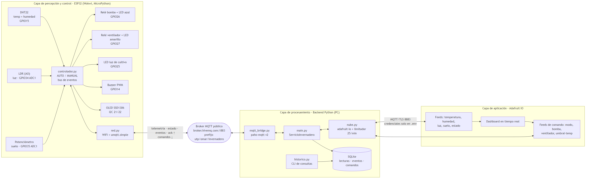
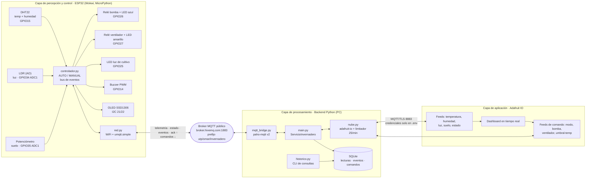
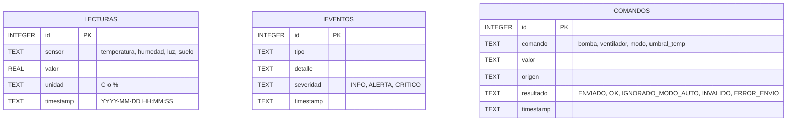

# Arquitectura IoT — Invernadero Inteligente

> Fuente del diagrama: [`img/arquitectura.mmd`](img/arquitectura.mmd). GitHub también renderiza el bloque Mermaid de abajo.

## 1. Capas

| Capa | Dónde corre | Responsabilidad | Tecnología |
|---|---|---|---|
| **Percepción y control** | ESP32 simulado en Wokwi | Leer sensores, aplicar reglas AUTO/MANUAL, accionar actuadores, mostrar en OLED | MicroPython, `machine.Pin/ADC/PWM/I2C`, `dht` |
| **Red** | ESP32 ⇄ Internet | Transportar telemetría, estado, eventos, comandos y ACKs | WiFi `Wokwi-GUEST`, MQTT (`umqtt.simple`) sobre HiveMQ público |
| **Procesamiento y persistencia** | PC | Guardar todo en SQLite, consultar históricos, puente con la nube, limitar la tasa hacia la nube | Python 3.10+, `paho-mqtt` v2, `sqlite3`, `logging` |
| **Aplicación (nube)** | Adafruit IO | Dashboard en tiempo real y envío de comandos al dispositivo | `adafruit-io` (MQTT/TLS 8883) |

## 2. Componentes de software

### Dispositivo (`wokwi/`)

| Módulo | Rol |
|---|---|
| `config.py` | Pines, tiempos, umbrales y parámetros MQTT. Única fuente de constantes. |
| `sensores.py` | `DHTSensor`, `SensorLuz` (invierte la polaridad del LDR), `SensorSuelo`. ADC1 con atenuación 11 dB. |
| `actuadores.py` | `Rele`, `Led`, `Buzzer` (PWM intermitente no bloqueante), `Pantalla` (SSD1306). |
| `controlador.py` | Lógica AUTO/MANUAL, histéresis, límite de riego, condición crítica y comandos. **No importa `machine`**: recibe los objetos por inyección de dependencias; por eso se prueba con pytest en la PC y lo reutiliza el simulador. |
| `red.py` | Máquina de estados WiFi → MQTT con reconexión, cola de mensajes pendientes y ping periódico. |
| `main.py` | Construye los objetos, conecta los eventos y ejecuta el bucle despachador de ~100 ms. |
| `ssd1306.py`, `umqtt_simple.py` | Drivers (MIT, micropython-lib). `umqtt_simple.py` es un respaldo: el firmware v1.28 de Wokwi ya trae `umqtt.simple` (verificado). Es un archivo plano porque Wokwi no admite carpetas. |

### Backend (`backend/`)

| Módulo | Rol |
|---|---|
| `config.py` | Carga `.env` con python-dotenv. Define feeds y unidades. |
| `mqtt_bridge.py` | `PuenteMQTT`: cliente paho v2 hacia HiveMQ; despacha cada topic a los manejadores registrados. |
| `nube.py` | `NubeAdafruit`: publica feeds, recibe comandos, `LimitadorTasa` (25/min, por debajo de los 30/min del plan gratis) y traducción feed → comando. |
| `db.py` | `BaseDatos`: aplica `sql/schema.sql`, inserta y ejecuta las consultas con nombre de `sql/consultas.sql`. Segura para hilos. |
| `main.py` | `ServicioInvernadero`: orquesta los eventos (telemetría → BD + nube; comando de la nube → BD + dispositivo; ACK → BD). Cierre limpio con Ctrl+C. |
| `historico.py` | CLI de consultas de históricos (argparse + tabla de texto). |
| `simulador_dispositivo.py` | Imita al ESP32 reutilizando `wokwi/controlador.py` con hardware simulado. |

## 3. Programación orientada a eventos

En el **dispositivo** no hay sondeo bloqueante:

1. **Callback MQTT**: `red.py` llama a `on_comando(dict)` cuando llega algo a `{prefijo}/comandos`.
2. **Temporizadores no bloqueantes**: `Temporizador.revisar()` usa `time.ticks_ms()`/`ticks_diff()` y dispara la lectura de sensores (2 s) y la telemetría (15 s).
3. **Bus de eventos**: `controlador.bus.emitir("evento"|"estado", ...)`. `main.py` suscribe funciones que publican por MQTT **en el momento** del cambio.
4. **Bucle corto**: ~100 ms y solo despacha: `red.mantener()`, los temporizadores y `controlador.tick()` (corte de riego a los 10 s y patrón del buzzer).

En el **backend**, los hilos de red de paho (HiveMQ y Adafruit IO) invocan los manejadores registrados con `puente.on(...)` y `on_comando`. El hilo principal solo espera la señal de cierre.

## 4. Decisiones de diseño

### ¿Por qué SQLite está en el backend y no en el ESP32?
- MicroPython **no tiene `sqlite3`** ni ningún motor SQL.
- El ESP32 tiene unos 100 KB de RAM libre y una flash que se desgasta con escrituras constantes.
- Centralizar la persistencia en el backend permite consultas SQL completas (`GROUP BY`, rangos de fechas, índices) y respaldos sencillos del archivo `.db`.

### Seguridad: el ESP32 no conoce las credenciales de la nube
- El firmware solo habla con HiveMQ. **La `AIO_KEY` vive únicamente en el `.env` del backend**, que git ignora.
- Si alguien extrae el firmware o mira el proyecto público de Wokwi, no obtiene acceso a la cuenta de Adafruit IO.
- La conexión backend ⇄ Adafruit IO usa TLS (puerto 8883).
- **Limitación conocida:** HiveMQ público no tiene autenticación; cualquiera que conozca el prefijo puede leer o publicar. El prefijo único (`utp/omar/invernadero`) evita colisiones, pero no es seguridad. En producción se usaría un broker privado con usuario/contraseña, TLS y ACL por topic (HiveMQ Cloud o EMQX Cloud tienen planes gratuitos). Como defensa adicional, el dispositivo **valida cada comando** (rango de `umbral_temp`, valores ON/OFF, modo) y responde `INVALIDO` si no corresponde.

### ¿Por qué un backend puente y no conectar el ESP32 directo a Adafruit IO?
- Protege las credenciales (punto anterior).
- Permite persistir todo en SQLite y aplicar el **límite de 30 datos/min** del plan gratuito en un solo lugar.
- Desacopla: si se cambia de nube (p. ej. a ThingSpeak), el firmware no se toca.

### Sensores analógicos solo en ADC1
El driver WiFi usa el ADC2 del ESP32, así que con WiFi activo sus lecturas fallan. Por eso el LDR va en GPIO34 y el potenciómetro en GPIO35 (ADC1), con atenuación de 11 dB para cubrir 0–3.3 V.

### Polaridad del LDR
En el módulo `wokwi-photoresistor-sensor`, más luz ⇒ menor resistencia de la LDR ⇒ **menor** voltaje en AO (según la documentación de Wokwi: 0.1 lux ≈ VCC y 100 000 lux ≈ 0 V). `SensorLuz.leer()` invierte la escala: `luz % = 100 − voltaje %`.

### Relés activos en alto
El `wokwi-relay-module` con su configuración por defecto se activa con IN en **alto**: `Pin.value(1)` conecta COM con NO y enciende el LED verde del módulo. Esto se **verificó en la simulación**: con el atributo `"transistor": "pnp"` la lógica se invierte, así que el diagrama lo deja sin ese atributo. Si se usa un relé activo en bajo, basta con poner `RELE_ACTIVO_ALTO = False` en `wokwi/config.py`.

Los LEDs azul y amarillo se alimentan **a través de COM→NO** (3V3 → COM, NO → 220 Ω → LED → GND), así que se ve al relé conmutar. Los relés están rotados 180° en el diagrama para que la entrada IN quede hacia el ESP32 y los contactos hacia los LEDs, lo que deja el cableado más corto y sin cruces.

### Confiabilidad
- WiFi y MQTT se reconectan solos (`red.py` en el ESP32; `reconnect_delay_set` de paho en el backend).
- Los eventos, el estado y los ACKs generados sin conexión se encolan (máx. 20) y se envían al reconectar. La telemetría no se encola, porque solo importa la más reciente.
- Los comandos llevan un `id` que el ESP32 devuelve en el ACK; así el backend actualiza la fila exacta de `comandos` (ENVIADO → OK / IGNORADO_MODO_AUTO / INVALIDO). Si el envío falla, queda `ERROR_ENVIO`.
- Todos los topics usan QoS 0: alcanza para telemetría periódica, y la confirmación de comandos se resuelve en la aplicación con el ACK.
- El broker público a veces tarda varios segundos en aceptar una conexión (se observó en las pruebas). Por eso los clientes reintentan y el backend no da un comando por enviado si no hay sesión activa.

## 5. Contrato MQTT (HiveMQ)

| Topic | Dirección | Payload JSON |
|---|---|---|
| `{prefijo}/telemetria` | ESP32 → backend | `{"temperatura":24.1,"humedad":60.2,"luz":72,"suelo":45,"ts":1763900000}` |
| `{prefijo}/estado` | ESP32 → backend | `{"modo":"AUTO","bomba":false,"ventilador":true,"luz_cultivo":false,"umbral_temp":30,"critico":false}` |
| `{prefijo}/eventos` | ESP32 → backend | `{"tipo":"RIEGO_INICIADO","detalle":"Suelo seco 25%","severidad":"INFO"}` |
| `{prefijo}/comandos` | backend → ESP32 | `{"cmd":"bomba","valor":"ON","origen":"adafruit_io","id":7}` |
| `{prefijo}/comandos/ack` | ESP32 → backend | `{"cmd":"bomba","valor":"ON","resultado":"OK","origen":"adafruit_io","id":7}` |

`id`, `origen` (en el ACK) y `critico` son campos adicionales al mínimo pedido. Son opcionales para quien publique comandos a mano.

**Tipos de evento:** `INICIO_SISTEMA`, `RIEGO_INICIADO`, `RIEGO_FINALIZADO`, `VENTILADOR_ON`, `VENTILADOR_OFF`, `LUZ_CULTIVO_ON`, `LUZ_CULTIVO_OFF`, `CAMBIO_MODO`, `UMBRAL_ACTUALIZADO`, `CRITICO`, `CRITICO_RESUELTO` y `ERROR_SENSOR` (severidad ALERTA).

## 6. Modelo de datos (SQLite)

Índices: `lecturas(timestamp)`, `lecturas(sensor, timestamp)`, `eventos(timestamp)`, `eventos(tipo, timestamp)`, `eventos(severidad)`, `comandos(timestamp)` y `comandos(comando, timestamp)`.

El timestamp guardado es el de **recepción en el backend** (hora local), porque el reloj del ESP32 depende de NTP. El `ts` del dispositivo viaja en la telemetría solo como referencia.
