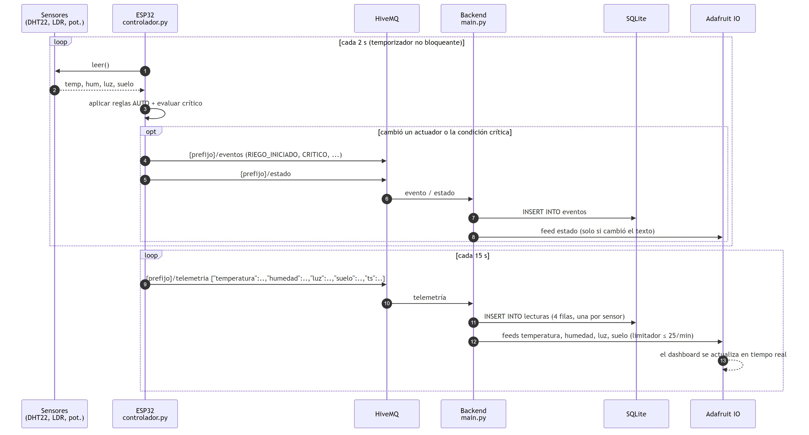
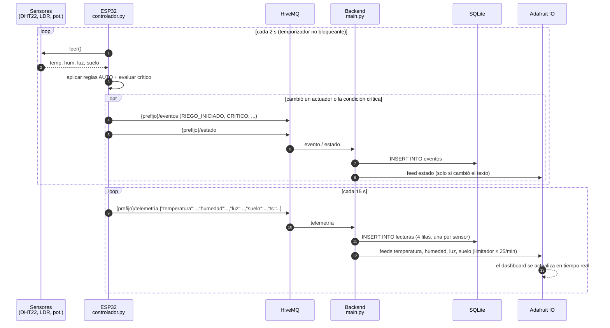
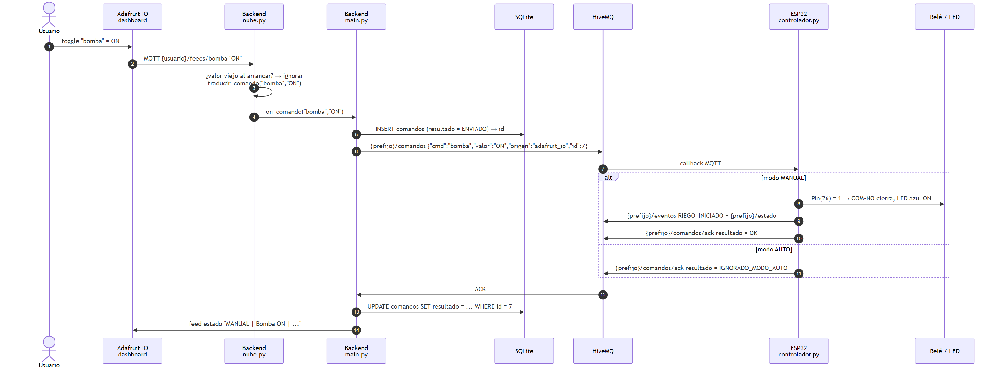
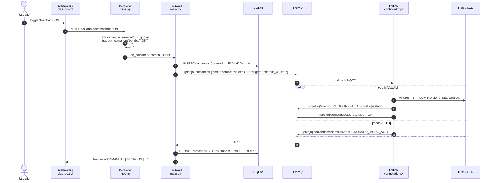
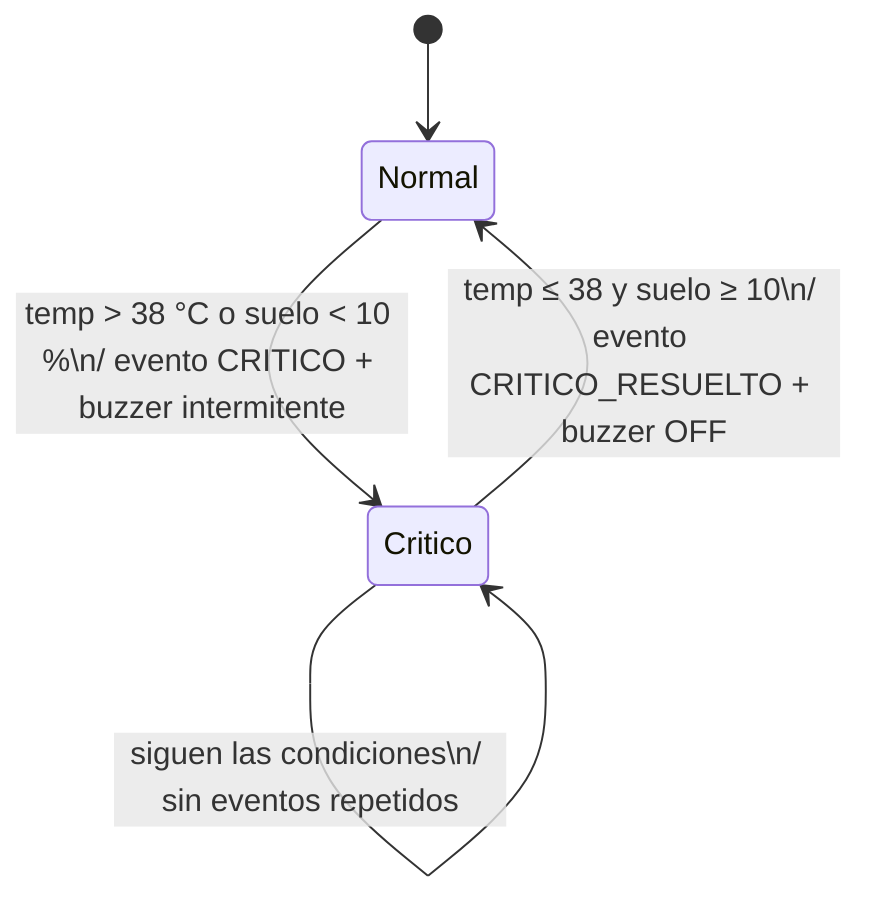

# Flujo de datos — Invernadero Inteligente

Dos flujos principales:

1. **Ascendente** (sensor → nube): lectura, reglas, eventos, telemetría, SQLite y dashboard.
2. **Descendente** (nube → actuador): comando del dashboard, backend, ESP32, relé y ACK.

## 1. Sensor → SQLite → Adafruit IO

**Presupuesto de datos hacia Adafruit IO:** 4 feeds × 4 mensajes/min = **16 datos/min**, más el feed `estado` solo cuando cambia. El `LimitadorTasa` del backend corta en 25/min, por debajo del límite de 30/min del plan gratis. Si no hay cupo, el estado queda pendiente y se envía en cuanto se libera la ventana.

## 2. Dashboard → actuador (con ACK)

## 3. Traducción de feeds de comando

| Feed de Adafruit IO | Valor recibido | Comando MQTT al ESP32 |
|---|---|---|
| `modo` | `AUTO` / `MANUAL` | `{"cmd":"modo","valor":"AUTO"\|"MANUAL"}` |
| `bomba` | `ON` / `OFF` (también `1`/`0`) | `{"cmd":"bomba","valor":"ON"\|"OFF"}` |
| `ventilador` | `ON` / `OFF` (también `1`/`0`) | `{"cmd":"ventilador","valor":"ON"\|"OFF"}` |
| `umbral-temp` | número (20–45) | `{"cmd":"umbral_temp","valor":32}` |

Los valores no reconocidos se reenvían tal cual: el ESP32 responde `INVALIDO` y queda registrado en `comandos`.

## 4. Resultados posibles de un comando

| Resultado | Significado |
|---|---|
| `ENVIADO` | El backend lo publicó y aún no llega el ACK. |
| `OK` | El dispositivo lo ejecutó (o ya estaba en ese estado). |
| `IGNORADO_MODO_AUTO` | Comando de bomba/ventilador recibido en modo AUTO. |
| `INVALIDO` | Comando o valor fuera de rango o desconocido. |
| `ERROR_ENVIO` | El backend no tenía sesión con HiveMQ al enviarlo. |

## 5. Condición crítica

